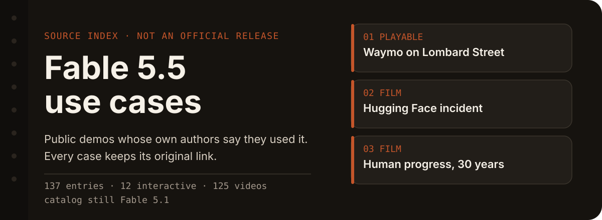
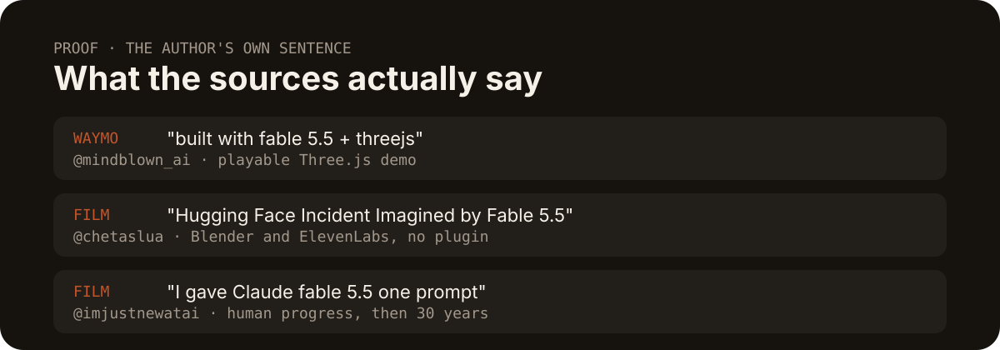
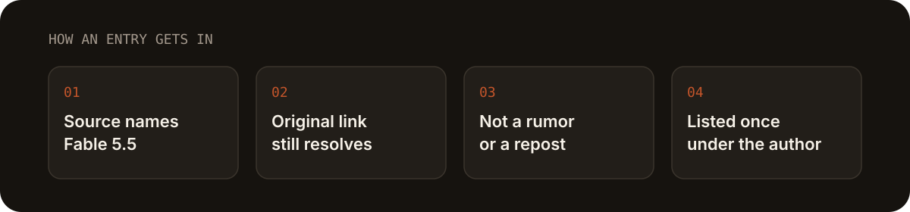

  

A curated list of **public use cases attributed to Claude Fable 5.5**, collected from GitHub, X, and Hacker News.

*Claude Fable 5.5 公开用例精选。只收录带来源链接的社区案例。*

**Status.** As of 2026-10-05, Anthropic's public model catalog still lists Claude Fable 5.1. This list does not claim an official Fable 5.5 release, and it does not copy rumored specs, prices, or benchmarks. An entry is included only when a public source says Fable 5.5 was used and the link still resolves.

138 entries (12 interactive / games, 126 videos). Last updated 2026-10-21.

  

## Featured

- [Waymo teleoperator](https://x.com/mindblown_ai/status/2106112279079199037) — @mindblown_ai — Playable Three.js Waymo run, including Lombard Street. **[Play](https://teleoperator.mindblown.ai)**. The post says "built with fable 5.5 + threejs".
- [Hugging Face incident](https://x.com/chetaslua/status/2105884276864782557) — @chetaslua — A Blender and ElevenLabs short the author says was "Imagined by Fable 5.5", all code, no skill or plugin.
- [Human progress, then 30 years](https://x.com/imjustnewatai/status/2106081142143168580) — @imjustnewatai — "I gave Claude fable 5.5 one prompt: a video of all human progress, then 30 years into the future."

## What this is

A source index, not a model card. The cases below are community posts. Each one is here because the author wrote Fable 5.5 in the post itself.

  

A post that only predicts a release, leaks a system prompt, or repeats someone else's video stays out. Nothing on this page is an official score, price, or spec.

  

## Interactive 3D and games

- [Waymo teleoperator on Lombard Street](https://x.com/mindblown_ai/status/2106112279079199037) — @mindblown_ai — A playable Three.js Waymo teleoperator on a San Francisco map. The post shows a run down Lombard Street and says it was built with Fable 5.5. **[Live demo](https://teleoperator.mindblown.ai)**
- [Lower Manhattan buildings by year](https://x.com/nroze22/status/2106183281293381661) — @nroze22 — An interactive architectural drawing of every building standing in Lower Manhattan today, drawn in the year it went up, which the author says Fable 5.5 returned from one prompt. **[Live demo](https://claude.ai/artifact/Tx5L1sQeXd4e7vp9DifrwK)**
- [Three-body problem in Bend2](https://x.com/zAdrielsan/status/2105822678519001360) — @zAdrielsan — A one-shot Bend2 three-body simulation the author says Fable 5.5 returned, with symplectic physics on the CPU, GPU pixels at 60 FPS, and four formally proven laws. **[GitHub](https://github.com/AdrielSantana/three-bodies)**
- [Clawd pixel bug-boss game](https://x.com/blueemi99/status/2107108802440900621) — @blueemi99 — A one-shot pixel game where you play as Clawd defeating bugs and bosses. The post says Claude Fable 5.5 made it. **[Live demo](https://claude.ai/artifact/Bor4eKVfaKakr6QSfoT8UZ)**
- [The Sun Machine](https://x.com/pankajkumar_dev/status/2106762987872850092) — @pankajkumar_dev — An interactive artificial sun with mirrors, aperture, and eclipse controls in a desert. The post says Fable 5.5 created the whole thing, with a video demo on the post.
- [Depths of Despair model redesign](https://x.com/atomtanstudio/status/2106900686764134654) — @atomtanstudio — The author says being routed to Fable 5.5 led them to redesign models and pacing in The Depths of Despair, playable in a browser. **[Live demo](https://threecade.games)**
- [POKERMON: Pokémon x Balatro](https://x.com/anshuc/status/2107180724399075488) — @anshuc — A Pokémon x Balatro card game the author says Fable 5.5 one-shot in one hour after they got access, including mechanics, visuals, music, and the demo video. **[Live demo](https://pokermon.anshu.dev)**
- [NIGHTSHIFT — Neon Circuit](https://x.com/Armaan_Jain123/status/2107251677615300969) — @Armaan_Jain123 — A browser game the author says Fable 5.5 made in one shot, with sound. **[Live demo](https://drift.hexclave.app)**
- [Fan product page for OpenAI Dots](https://x.com/JaydenDavisNC/status/2107224501415277040) — @JaydenDavisNC — A fan-made product page for OpenAI Dots that the author says they built using Fable 5.5 and its Blender capabilities. **[Live demo](https://dots-fan-concept.inkwave.workers.dev)**
- [Sealed rainforest in three.js (Silva Minima)](https://x.com/RobinDenmark/status/2108194732744888801) — @RobinDenmark — A sealed montane rainforest in three.js that the author says Fable 5.5 created over about 14 hours. **[Live demo](https://silva-minima.vercel.app/)**
- [Sam Altman clay bust in 3D](https://x.com/designwkarthick/status/2110449490901848483) — @designwkarthick — An interactive 3D clay bust of Sam Altman with front, side, studio, live-light, clay, and turntable views. The author shares it as a Claude artifact and says Claude Fable 5.5 did an amazing job, in a quote of their earlier ChatGPT Dots version. **[Live demo](https://claude.ai/artifact/5NR9DHB8zzWMr3Lo9o3aSK)**
- [Screenshot Heist, a little browser game](https://x.com/dummerspast39/status/2111941623034634356) — @dummerspast39 — A small browser game the author says they made with Fable 5.5 in Claude.ai, with a play video on the post. **[Live demo](https://screenshot-heist-oct18.dummerspast39.chatgpt.site/)**

## Videos from X

Video works whose authors attribute them to Claude Fable 5.5. Each item links the creator's original X post (`@author`). Posts were checked via `api.fxtwitter.com` (2026-10-03, 2026-10-04, and 2026-10-05), or via the X API (2026-10-06, 2026-10-07, 2026-10-08, 2026-10-09, 2026-10-10, 2026-10-12, and 2026-10-13; the 2026-10-10 set was rechecked via api.fxtwitter.com on 2026-10-11), to exist, to say Fable 5.5 in their own text, and to carry a native video or still artifact. Reposts of the same video are listed once, under the original creator. These posts are community claims. They are not an official model card. 126 entries.

### Motion design and code-drawn animation

- [15-minute animation from one line](https://x.com/cherry_mx_reds/status/2105816670896009224) — @cherry_mx_reds — A short animation the author says Fable 5.5 made about 15 minutes after the prompt "Hey Fable, please make a cool animation."
- [Pixar side quest from a dot](https://x.com/cherry_mx_reds/status/2105825930799432073) — @cherry_mx_reds — A short cartoon the author says Fable 5.5 produced from a request for a dot, described as a Pixar side quest.
- [Superman across art styles](https://x.com/chetaslua/status/2105757136219504862) — @chetaslua — A continuous Superman animation that changes art style, which the author attributes to Fable 5.5.
- [Marvel and DC heroes in pure JS](https://x.com/chetaslua/status/2105792187200147541) — @chetaslua — A one-shot pure-JavaScript Marvel and DC heroes piece. The author says Fable 5.5 chose the character details and edited the video.
- [Fast motion-design video](https://x.com/blueemi99/status/2106031355922387163) — @blueemi99 — A short fast motion video the author says Fable 5.5 made, and which they compare with earlier Opus 5.5 motion work.
- [Halloween piece told not to show off](https://x.com/cherry_mx_reds/status/2106056643255447590) — @cherry_mx_reds — A Halloween animation the author says they asked Fable 5.5 to make, after telling it not to show off.
- [Viral memes, 2010 to 2026](https://x.com/chetaslua/status/2106076940558082297) — @chetaslua — A pure-code tour of a viral meme for each year from 2010 through 2026, each in its own art style and music, which the author attributes to Fable 5.5.
- [40,000 years of art history](https://x.com/cherry_mx_reds/status/2106095190285144331) — @cherry_mx_reds — A 15-second art-history animation with a cat subplot that the author says they got after asking Fable, and which they attribute to Fable 5.5.
- [Spider-Man across ten comic eras](https://x.com/chetaslua/status/2106248621519978867) — @chetaslua — A Spider-Man piece across ten comic eras that the author attributes to Fable 5.5.
- [Queens of the Stone Age kinetic lyric video](https://x.com/atomtanstudio/status/2106135196483608745) — @atomtanstudio — A kinetic typography music video for Songs for the Deaf that the author says Fable 5.5 made on max reasoning after they attached the song in Claude.
- [Propellerheads lyric video](https://x.com/atomtanstudio/status/2106353569603736009) — @atomtanstudio — A long lyric video for Propellerheads — On Her Majesty's Secret Service that the author calls another Fable 5.5 masterpiece.
- [Chemical Brothers Go lyric video](https://x.com/atomtanstudio/status/2106377491267137848) — @atomtanstudio — A Chemical Brothers — Go lyric video the author says they made using Fable 5.5 on Max reasoning, using about 3% of weekly Fable allowance.
- [Day in the Life of Claude](https://x.com/ishuagra02/status/2106045364868419727) — @ishuagra02 — An animated short about a day in the life of Claude that the author says was animated by Fable 5.5.
- [clawdhouse intro video](https://x.com/ishuagra02/status/2106138602073641241) — @ishuagra02 — A promo video for the clawdhouse Claude Code mod that the author says was created with Fable 5.5.
- [Claude hits the beat](https://x.com/ishuagra02/status/2106369929813594134) — @ishuagra02 — A rhythm animation the author says was animated by Fable 5.5.
- [One-prompt motion video](https://x.com/devswha/status/2106100273509007802) — @devswha — A motion video the author says they made with Fable 5.5 from one detailed prompt, with no assets, reference video, or source files.
- [One-line prompt motion clip](https://x.com/devswha/status/2106072107365114186) — @devswha — A short motion clip the author says came from a one-line prompt with Fable 5.5.
- [Kung-Fu Boy](https://x.com/HashmathRzz/status/2106065773336965510) — @HashmathRzz — A short titled Kung-Fu Boy that the author says was made with Fable 5.5.
- [Iron Man and Spider-Man through history](https://x.com/imjustnewatai/status/2106162924331180510) — @imjustnewatai — A short the author says they asked Claude Fable 5.5 to make of Iron Man and Spider-Man flying through history.
- [Glucose glycolysis animated SVG](https://x.com/olddonkeyblog/status/2106508425211330750) — @olddonkeyblog — An animated SVG embedded in HTML of a glucose molecule going through glycolysis into ethanol, which the author attributes to Fable 5.5 Max.
- [Sixteen Starships launch animated SVG](https://x.com/olddonkeyblog/status/2106507742454403485) — @olddonkeyblog — An animated SVG embedded in HTML of sixteen Starships launching, separating stages, and entering space, which the author attributes to Fable 5.5 Max.
- [Pelican on a bicycle, Fable 5.5 Max](https://x.com/olddonkeyblog/status/2106507429265756165) — @olddonkeyblog — A pelican-on-a-bicycle test piece the author attributes to Fable 5.5 Max.
- [Pelican riding a bicycle SVG](https://x.com/olddonkeyblog/status/2105842745189556672) — @olddonkeyblog — A self-contained SVG of a pelican riding a bicycle that the author attributes to Fable 5.5 on max effort.
- [Penguin riding a donkey SVG](https://x.com/imjustnewatai/status/2109821687151690008) — @imjustnewatai — An SVG of a penguin riding a donkey that the author says they got after asking Claude Fable 5.5's latest checkpoint for it.
- [Unicorn in TikZ](https://x.com/imjustnewatai/status/2109824086582890931) — @imjustnewatai — A unicorn drawn in TikZ that the author says they asked Fable 5.5 to create.
- [What would make Fable 5.5 better](https://x.com/DAssetBuzz/status/2106505100575592838) — @DAssetBuzz — A roughly 25-second video the author says they asked Fable 5.5 to make about what would make it better.
- [40-second brand launch ad](https://x.com/0xashtonx/status/2106421702783914423) — @0xashtonx — A 40-second launch ad for the author's own brand that they say they asked Fable 5.5 to make.
- [Imagined Switch 3 product demo](https://x.com/mathisbuilds/status/2106407842240418097) — @mathisbuilds — A product-demo style presentation the author says Fable 5.5 Max made after they asked it to imagine the Switch 3, working for about four hours.
- [Oil painting and timelapse](https://x.com/blueemi99/status/2106755903223664708) — @blueemi99 — An oil painting and its timelapse that the author says Fable 5.5 made.
- [Eminem Godzilla, every frame in JavaScript](https://x.com/abhinavflac/status/2106638839666373114) — @abhinavflac — A recreation of Eminem's Godzilla that the author says Fable 5.5 made, with every frame drawn in JavaScript from traced flat shapes.
- [Ten illusions video](https://x.com/imjustnewatai/status/2106909392301945180) — @imjustnewatai — A video of ten illusions the author says they asked Claude Fable 5.5 to make.
- [Vizzbees motion design](https://x.com/Blushneyy/status/2106893568828928305) — @Blushneyy — A motion-design piece the author says was fully made by Fable 5.5 from the prompt "make a motion design for vizzbees" with no further direction.
- [White Town — Your Woman lyric video](https://x.com/atomtanstudio/status/2106702854639743467) — @atomtanstudio — A lyric music video for White Town — Your Woman. The author says they needed to save Fable 5.5 quota and this was the last lyric video before reset.
- [Never-seen optical illusion](https://x.com/imjustnewatai/status/2107092333720449392) — @imjustnewatai — An optical illusion the author says they asked Fable 5.5 to make that has never been made or seen before.
- [Thou Shalt Always Kill lyric video](https://x.com/atomtanstudio/status/2107105998452539639) — @atomtanstudio — A lyric video for Dan Le Sac vs Scroobius Pip — Thou Shalt Always Kill that the author says they made to challenge Fable 5.5 with a lyrically dense song.
- [Classic stick fight animation](https://x.com/AndrewOnXYZ/status/2107262468502544435) — @AndrewOnXYZ — A classic stick-figure fight the author says they asked Fable 5.5 to make, with very smooth animation.
- [Upcoming game UI recreation](https://x.com/m_ferreira28/status/2107218218955788429) — @m_ferreira28 — A recreation of the UI from an upcoming game that the author says they asked Fable 5.5 to make, and which they say came out the same.
- [Hello Claude](https://x.com/ishuagra02/status/2107164574239604925) — @ishuagra02 — A short animation titled Hello Claude that the author says was animated by Fable 5.5.
- [Brainrot edit for $25](https://x.com/blueemi99/status/2107459553369760024) — @blueemi99 — A brainrot-style video edit the author says Fable 5.5 made, noting that it cost $25.
- [Rainbow Bridge scene from Along the River During the Qingming Festival](https://x.com/AISuperDomain/status/2107401979265962490) — @AISuperDomain — A recreation of the Rainbow Bridge scene from the scroll painting Along the River During the Qingming Festival, with sound, that the author says Fable 5.5 generated.
- [Claude vs GPT](https://x.com/notjazii/status/2107497752217460896) — @notjazii — A Claude vs GPT animation with sound that the author says Fable 5.5 made with code on high reasoning.
- [Reference recreation in under an hour](https://x.com/notdwd/status/2107816799840690589) — @notdwd — A recreation of a reference motion piece that the author says Fable 5.5 made in less than one hour from a skill and a prompt.
- [JavaScript IK animation in the wind](https://x.com/adam_fresko/status/2107637770873417894) — @adam_fresko — An animation made entirely in JavaScript, with IK that reacts to wind and no 3D models or 2D sprites, which the author says they tested during one day of Fable 5.5 access.
- [Max-effort video](https://x.com/mikeswarms/status/2108066999590908018) — @mikeswarms — A video the author says they made with Fable 5.5 on max effort, noting an API cost of $68.
- [Human history in scribbles](https://x.com/oalanicolas/status/2107958931230241037) — @oalanicolas — An 88-second film across 16 eras that the author says they asked Fable 5.5 to tell as the history of humanity in scribbles, with period art techniques and music that change by era.
- [Millennial Flash-style animation](https://x.com/YanqingCheng/status/2108296567166042404) — @YanqingCheng — A roughly 100-second animation in peak 00s Flash style that the author says they asked Fable 5.5 to one-shot.

- [Pure math music visualization](https://x.com/chetaslua/status/2111060420505268729) — @chetaslua — A pure-math music and visualization piece the author labels as Fable 5.5, noting grey testing that routes Opus 5.5 to Fable 5.5 / Claude next model, with a knowledge-cutoff check against VoxelBench.
- [Music and sound-effect sync to video](https://x.com/chetaslua/status/2111087834329399635) — @chetaslua — A code-drawn piece the author labels as Fable 5.5, saying music and sound-effect sync to video is better than what Opus can draw.
- [New York cinematic scene, one shot in code](https://x.com/Mr_Salio/status/2111097153074470950) — @Mr_Salio — A New York cinematic scene with reflections and lighting that the author says Fable 5.5 made in one shot, everything in code.
- [Superman in 3D across art styles](https://x.com/chetaslua/status/2111458379386523724) — @chetaslua — A continuous Superman animation that moves through different art styles in 3D, which the author labels as Fable 5.5 and says was coded in Python using Blender.
- [Tesla Roadster reveal from one reference image](https://x.com/Mr_Salio/status/2111209558899413482) — @Mr_Salio — A Tesla Roadster reveal video that the author titles as Fable 5.5, saying they gave it one reference image and it took around 10 hours.
- [Pelican riding a bike](https://x.com/dummerspast39/status/2111391206848503923) — @dummerspast39 — A pelican riding a bike that the author titles as Fable 5.5.
- [SVG of a controller riding a bicycle riding a pelican](https://x.com/dummerspast39/status/2111577334436319355) — @dummerspast39 — An SVG animation of a controller riding a bicycle riding a pelican riding a bicycle riding a pelican, which the author titles as Fable 5.5.
- [Boat floating in a garden, one shot](https://x.com/pankajkumar_dev/status/2111518872272814233) — @pankajkumar_dev — A night scene of a boat floating in a garden, with water reflections, trees, mountains, birds, a bridge, and lights, which the author says Fable 5.5 made in one go from a short request.
- [Spider-Man scene from scratch in code](https://x.com/Mr_Salio/status/2111590674961154433) — @Mr_Salio — A Spider-Man scene in the style of a game cinematic that the author says Fable 5.5 built from scratch using only code, over about 7 hours. The author says the output came through Opus 5.5 routing.
- [PS1 boot into Crash Bash, drawn in code](https://x.com/kaa3bi/status/2111792945712255068) — @kaa3bi — A recreation of a PlayStation boot sequence going into Crash Bash, which the author says Fable 5.5 drew frame by frame in code.
- [Tesla Roadster landing page, Fable 5.5 vs Fable 5.1](https://x.com/kaif9998/status/2112166153250607201) — @kaif9998 — A side-by-side of two Tesla Roadster landing pages from the same prompt. The author says Fable 5.1 did a decent job and Fable 5.5 made the stronger page.
- [The Last Train Home](https://x.com/pankajkumar_dev/status/2112176644018626840) — @pankajkumar_dev — A cinematic Japanese night scene with lantern-lit streets, rain-soaked pavement, and a train passing through the city, which the author says they asked Fable 5.5 to create.
- [Dyson Fragment, single HTML](https://x.com/dummerspast39/status/2112275947634446639) — @dummerspast39 — A 91-second video piece titled Dyson Fragment, which the author says Fable 5.5 made as a single HTML file in about 1.5 hours.
- [SVG of a horse riding an astronaut](https://x.com/dummerspast39/status/2112490492684296664) — @dummerspast39 — A short video of an SVG drawing of a horse riding an astronaut, which the author titles as Fable 5.5.
- [Character workflow factory](https://x.com/luccacerf/status/2112499975989190948) — @luccacerf — A screen video of a character workflow factory that the author says Fable 5.5 created for them. The author says it is almost finished and plans to share it when it is done.
- [Luminescent river on a quiet night](https://x.com/scottstts/status/2112601036804243871) — @scottstts — A 54-second video with sound of a glowing river on a quiet night, which the author says Fable 5.5 created.

### Interactive 3D

- [Voxel build of yourself](https://x.com/blueemi99/status/2105804692811137242) — @blueemi99 — A voxel scene the author titles as a Fable 5.5 build of yourself, with the hedge that it might be the new model because it looks better than Fable 5.1 and Opus 5.5.
- [Zero-shot voxel world and a DMC game](https://x.com/OnlyTerp/status/2106089280502210626) — @OnlyTerp — Two native videos on one post: a zero-shot voxel world the author says came out better than Fable 5.1, and a Devil May Cry-style game they say they asked Fable 5.5 to make, generated over about 2.5 hours on max.
- [Fable 5.5 vs Fable 5.1 comparison clip](https://x.com/marcthecreatorr/status/2106369223312240928) — @marcthecreatorr — A side-by-side style comparison the author presents as Fable 5.5 versus Fable 5.1, saying the 5.5 result took about 10 minutes from a single prompt.
- [Minecraft in the Pokemon world](https://x.com/MozeTech/status/2106590326634983710) — @MozeTech — A one-shot merge of Minecraft crafting and building into Pokemon's Pallet Town that the author says was made with Fable 5.5 (rerouting).
- [Castle bench scene](https://x.com/nemumusitocha/status/2106429338556207284) — @nemumusitocha — A detailed castle bench scene the author attributes to Claude Fable 5.5, with photos and a short video of the build.
- [3D Rube Goldberg machine](https://x.com/imjustnewatai/status/2105889407056109991) — @imjustnewatai — A one-minute 3D Rube Goldberg machine the author says Claude Fable 5.5 returned from a single prompt asking for accurate physics and AAA graphics.
- [Dig Dug in one HTML file](https://x.com/imjustnewatai/status/2105831117677084841) — @imjustnewatai — A Dig Dug recreation the author says Fable 5.5 produced as a single HTML file from one prompt.
- [Dead Frame mech fighting game WIP](https://x.com/BenSutc02184861/status/2106741529297699145) — @BenSutc02184861 — A work-in-progress mech fighting game clip the author says was made with Claude Fable 5.5, Unity, and Higgsfield.
- [San Francisco Map](https://x.com/HelloVyom/status/2106741444778336595) — @HelloVyom — A San Francisco map video the author titles as Fable 5.5. Distinct media from the earlier Waymo teleoperator demo.
- [Model, rig, and animate pipeline vs Opus 5.5](https://x.com/atomtanstudio/status/2106516974662713477) — @atomtanstudio — A side-by-side from the author's Depths of Despair game comparing Opus 5.5 and Fable 5.5 on Max reasoning for a full model-creation, rigging, and animation pipeline with no third-party assets.
- [Rocketball C-64 remake](https://x.com/atomtanstudio/status/2106418747083022555) — @atomtanstudio — A code-only remake of the 1980s C-64 Rocketball game that the author says was created with Fable 5.5 on Max reasoning, with a planned publish to threecade.games.
- [Blender animation, music, models, and rigging](https://x.com/JaydenDavisNC/status/2107086714820870617) — @JaydenDavisNC — A Blender animation the author says Fable 5.5 made, with music, models, animation, and rigging done using Fable 5.5.
- [Sci-fi game UI and 3D maps for Roblox](https://x.com/MyCodeCoach/status/2107267599843422699) — @MyCodeCoach — Sci-fi game UI and 3D map generation the author credits to Fable 5.5, imported directly into Roblox.
- [GTA-style game in the browser](https://x.com/oalanicolas/status/2107803303832936679) — @oalanicolas — A GTA-style open-world game running fully in the browser that the author says they made with Fable 5.5 and Opus 5.5.
- [Static 3D model to sword combat set](https://x.com/romance0x/status/2107770247893623240) — @romance0x — A sword combat set, including a spin slash, that the author says Fable 5.5 made from one static Tripo 3D model in a T-pose.
- [Minecraft clone oneshot](https://x.com/blueemi99/status/2108221060655055242) — @blueemi99 — A Minecraft clone the author says Fable 5.5 oneshot in under an hour, including UI, graphics, mobs, biomes, caves, and items.
- [Four-model 3D comparison including Fable 5.5](https://x.com/SPAC89/status/2107928401516400827) — @SPAC89 — A side-by-side 3D comparison the author presents after testing Grok 4.7 XHigh, Haiku 5.5 Max, Fable 5.5, and GPT-6.1 Sol Ultra.
- [Minecraft-style build with weather and mobs](https://x.com/notjazii/status/2108590346309706221) — @notjazii — A Minecraft-style game the author says Fable 5.5 made once it was routing again, adding weather, mobs, suits, weapons and more, with a playable Claude artifact linked in the post. **[Play](https://claude.ai/artifact/7S2aKLz9sN33mk9sVFhfAc)**
- [Rhythm game with its own sounds](https://x.com/blueemi99/status/2108912164253602187) — @blueemi99 — A rhythm game the author says they made with Opus and Fable 5.5, which made all the sounds and the game, with a playable Claude artifact linked in the post. **[Play](https://claude.ai/artifact/9KzwLCTm1Wr4ghvPmoM5sA)**
- [Explorable Qingming scroll Rainbow Bridge](https://x.com/AISuperDomain/status/2108878175531110875) — @AISuperDomain — An explorable 3D scene of the Rainbow Bridge section of Along the River During the Qingming Festival, where you can switch scenes and camera angles, which the author credits to Fable 5.5's front-end skills (Chinese).
- [Fish locomotion comparison: Fable 5.5 (or Opus 5.6) vs Opus 5.5 vs GPT-6 Astra](https://x.com/AI_Screening/status/2109323163016613932) — @AI_Screening — A side-by-side fish animation comparison that the author labels as Fable 5.5 (or Opus 5.6) versus Opus 5.5 and GPT-6 Astra, saying the Fable 5.5 result masters fluid locomotion and realistic fish anatomy.
- [Three.js scene in a single HTML file](https://x.com/beyondwudan/status/2109432722250957122) — @beyondwudan — A Three.js scene in one HTML file that the author credits to Fable 5.5. The author's earlier quoted post says they got this output through Opus 5.5 routing.
- [Stretchable glowing jellyfish, Fable 5.5 Xhigh vs GPT-6.1 Sol Ultra](https://x.com/romance0x/status/2109704094126682274) — @romance0x — A side-by-side clip of one glowing jellyfish you can stretch, slice into pieces, and watch pull itself back together. The author presents one side as Fable 5.5 Xhigh.
- [Pandora planet game](https://x.com/AISuperDomain/status/2111011773369512314) — @AISuperDomain — A game set on Pandora that the author says Fable 5.5 made (Chinese).
- [Voxel build on one VoxelBench prompt](https://x.com/legit_api/status/2111193444345667813) — @legit_api — A video of the voxel build that the author says Fable 5.5 made for one of their VoxelBench prompts. No score is copied here.
- [Minecraft in a single HTML file](https://x.com/dummerspast39/status/2111464346010152967) — @dummerspast39 — A Minecraft-style game in one HTML file that the author titles as Fable 5.5.
- [Zelda in the Pokemon world, one shot](https://x.com/MozeTech/status/2111652513846026593) — @MozeTech — A crossover game that puts Zelda: Breath of the Wild in a Pokemon-style world, where you fight Calamity Ganon, collect Korok seeds, and catch Pokemon. The author says they made it in one shot with Fable 5.5 through rerouting.
- [Hogwarts Castle voxel in a single HTML file](https://x.com/dummerspast39/status/2111545177949209014) — @dummerspast39 — A video of a Hogwarts Castle voxel build in one HTML file that the author says Fable 5.5 generated. The author says another model edited the video and voice-over.
- [Voxel propaganda piece](https://x.com/dummerspast39/status/2111957286620930535) — @dummerspast39 — A voxel video the author says Claude Fable 5.5 produced after about two minutes of prompting.

### Films

- [Hugging Face incident, Blender and ElevenLabs](https://x.com/chetaslua/status/2105884276864782557) — @chetaslua — A short the author says Fable 5.5 imagined about a Hugging Face incident, made with code, Blender, and the ElevenLabs API, with no skill or plugin.
- [Song lyrics tied to the Hugging Face incident](https://x.com/chetaslua/status/2105934928483701214) — @chetaslua — A follow-up film the author says Fable 5.5 made by connecting a song's lyrics with the Hugging Face incident.
- [Civilization from day one, all code](https://x.com/ziwenxu_/status/2105983571848741045) — @ziwenxu_ — A code-drawn film the author says Claude Fable 5.5 made from the challenge to show civilization from day one, with no footage and no stock.
- [The Universe Looks at Itself](https://x.com/l_mejiaC/status/2105988529671360673) — @l_mejiaC — A continuous shot the author attributes to Fable 5.5, from the Big Bang to a human eye, with every frame and the music computed in code.
- [Human progress, then 30 years on](https://x.com/imjustnewatai/status/2106081142143168580) — @imjustnewatai — A roughly three-minute animated film with an original score that the author says Claude Fable 5.5 returned from one prompt about all human progress and 30 years into the future, with no footage and no stock music.
- [Quarks to the observable universe](https://x.com/imjustnewatai/status/2106190594775097663) — @imjustnewatai — A 94-second unbroken zoom from three quarks to the observable universe. The author says Claude Fable 5.5 picked the idea, and that the visuals and music are code rather than a video model.
- [Scary illuminati video](https://x.com/badboyfoxy/status/2106241189976387799) — @badboyfoxy — A scary video about the Illuminati that the author says they asked Fable 5.5 to make.
- [Fable 5.5 introduction video](https://x.com/devteamdrew/status/2106155815707021549) — @devteamdrew — An introduction video the author says they asked Fable 5.5 to create for itself in a single prompt, including visuals and music.
- [Humanity walks across 30,000 years of art](https://x.com/l_mejiaC/status/2105801379956850793) — @l_mejiaC — A 74-second code-drawn film of one person crossing 30,000 years of art across 20 style plates, which the author says was made with Fable 5.5.
- [How a large language model is made](https://x.com/imjustnewatai/status/2106546810793730419) — @imjustnewatai — A short film the author says they got after asking Fable 5.5 how a large language model is made.
- [Next 150 years of humanity](https://x.com/imjustnewatai/status/2106489784382197771) — @imjustnewatai — A roughly four-minute animated film from 1986 to 2176 that the author says Claude Fable 5.5 wrote, animated in code, and scored from one prompt.
- [Code-drawn film with ElevenLabs v4](https://x.com/argofowl/status/2106476549046513947) — @argofowl — A one-shot code-drawn piece the author attributes to Fable 5.5/5.2 plus ElevenLabs v4, saying it took about 2 hours 22 minutes to generate.
- [How the atomic bomb became possible](https://x.com/imjustnewatai/status/2106238699872956427) — @imjustnewatai — A three-minute 3D film the author says Claude Fable 5.5 made by writing its own renderer, drawing 5,400 frames, and synthesizing a soundtrack, with no 3D library to start from.
- [Altman–Amodei feud explainer](https://x.com/imjustnewatai/status/2106204392588276065) — @imjustnewatai — An explainer short the author says they asked Claude Fable 5.5 to make about the Altman–Amodei feud.
- [The world in 2076](https://x.com/mdaman010/status/2106397723868221458) — @mdaman010 — A short the author says they asked Fable 5.5 to make imagining the world in 2076.
- [How being an AI model feels from the inside](https://x.com/blueemi99/status/2106397329653719115) — @blueemi99 — A one-shot film the author titles as Fable 5.5 showing how being an AI model feels from the inside.
- [Black hole renderer from scratch](https://x.com/imjustnewatai/status/2106925762582323550) — @imjustnewatai — A Python black-hole renderer the author says Claude Fable 5.5 wrote from scratch after they asked for the hardest edit, bending each pixel as a light ray around a non-rotating black hole, with no game engine or stock footage.
- [Fastlane vs Relay explainer](https://x.com/EndrewBiz/status/2106806557753106841) — @EndrewBiz — An explainer video the author says they asked Fable 5.5 to make about the fight between Fastlane and Relay.
- [Navier–Stokes proof in eight steps](https://x.com/imjustnewatai/status/2107590323128193174) — @imjustnewatai — A five-minute 3D video the author says Claude Fable 5.5 made when asked to explain OpenAI's Navier–Stokes proof, laid out in eight steps.
- [Zeta zero-free strip proof explainer](https://x.com/imjustnewatai/status/2107615459822453187) — @imjustnewatai — A two-minute 3D animation the author says Claude Fable 5.5 returned when asked to explain OpenAI's quasi-Riemann hypothesis proof about zeros of zeta.
- [Free group factor problem explainer](https://x.com/imjustnewatai/status/2107625700307960144) — @imjustnewatai — A two-minute 3D animation the author says Claude Fable 5.5 returned when asked to explain OpenAI's proof on the free group factor problem.
- [Unique Games Conjecture proof explainer](https://x.com/imjustnewatai/status/2107618885575053818) — @imjustnewatai — A two-minute 3D animation the author says Claude Fable 5.5 returned when asked to explain OpenAI's Unique Games Conjecture proof.
- [Hodge conjecture proof explainer](https://x.com/imjustnewatai/status/2107622524615832047) — @imjustnewatai — A two-minute 3D animation the author says Claude Fable 5.5 returned when asked to explain OpenAI's Hodge conjecture proof for a family of shapes.
- [OpenAI 722 papers visualization](https://x.com/Kris_2233/status/2108046188125516246) — @Kris_2233 — A visualization of OpenAI's 722 papers that the author attributes to Fable 5.5.
- [Erdős arithmetic-progressions proof explainer](https://x.com/imjustnewatai/status/2108021409461244371) — @imjustnewatai — A roughly two-minute narrated 3D animation the author says Claude Fable 5.5 returned when asked to explain OpenAI's 198-page proof of a 50-year-old Erdős conjecture on arithmetic progressions.
- [π irrationality-exponent proof explainer](https://x.com/imjustnewatai/status/2107970825542345211) — @imjustnewatai — A narrated roughly two-minute 3D animation the author says Claude Fable 5.5 returned when asked to explain OpenAI's 23-page proof that the irrationality exponent of π is exactly 2.
- [Early-access video](https://x.com/finnatsea/status/2108489320957137300) — @finnatsea — An 11-minute video that the author says Fable 5.5 made after they got early access.
- [Symphony in four movements, with video](https://x.com/imjustnewatai/status/2109191246715462070) — @imjustnewatai — A 9:38 symphony in four movements, with a video of every note, that the author says Claude Fable 5.5 produced in about four hours from two prompts: "Write a beautiful symphony" and "record a video of it when you're done."
- [Hosanna: a musical where the model sings its own introduction](https://x.com/ChrisGPT/status/2109570757579649086) — @ChrisGPT — A religious musical called "Hosanna" that the authors say Fable 5.5 made when @ChrisGPT and @chetaslua asked it for a song introducing itself, using Suno for the music, ElevenLabs for the vocals, and a synchronized Three.js music video.
- [From "strawberry" to a Millennium Prize claim](https://x.com/imjustnewatai/status/2109811005395996875) — @imjustnewatai — A video about AI breakthroughs that the author says Claude Fable 5.5 made end to end: it researched the breakthroughs, wrote the script, built 21 3D scenes, composed the music in code, and rendered 3,240 frames.
- [Launch video in Blender and ElevenLabs](https://x.com/chetaslua/status/2111157145102397817) — @chetaslua — A launch-style video that the author says Fable 5.5 made with pure Python code in Blender and ElevenLabs, after they only provided an X video of a launch.
- [Celebration video for 5k GitHub stars](https://x.com/dummerspast39/status/2111671322015043759) — @dummerspast39 — A short celebration video for the Chat on steroids project reaching 5k GitHub stars, which the author says they made with Fable 5.5.
- [Song generated completely in code](https://x.com/dummerspast39/status/2112085543563440223) — @dummerspast39 — A short music piece the author says Fable 5.5 generated completely in code.
- ["2slimey type beat" in Python](https://x.com/dummerspast39/status/2112119732174303735) — @dummerspast39 — A beat the author says Fable 5.5 made with Python from the prompt "2slimey type beat". The author jokes that it sounds like Japanese dubstep, not the style they asked for.
- [Sad AlbertX The Movie](https://x.com/SadAlbert10/status/2112259952224141654) — @SadAlbert10 — A five-minute voxel movie with TTS voices that the author says they made, with Fable 5.5 credited as editor. The author credits Fish Audio for speech and Kreiin for the music.

Routing rumors, release predictions, and roundups that do not themselves present an artifact are left out. No benchmark pages. Nothing here is an official Fable 5.5 score, price, or spec.

## Contributing

See [CONTRIBUTING.md](CONTRIBUTING.md).

## License

  
  

[CC0 1.0](LICENSE).
